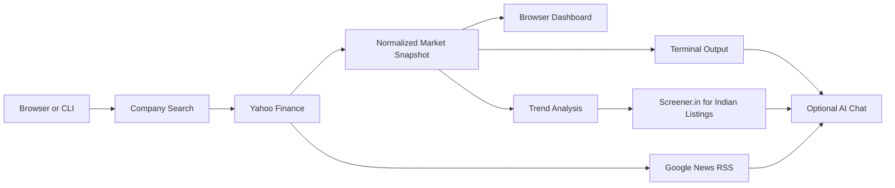

# Market Lens

Market Lens is a Python market-research toolkit that turns company names into useful public-market information.

Search for a company, compare a business with its market listing, inspect historical trends, and optionally ask an AI assistant questions about the collected data.

The project is available as:

- A lightweight browser dashboard
- A command-line trend report
- An interactive AI chatbot
- A terminal company snapshot

It is designed for learning, portfolio research, and experimentation—not investment advice.

## Features

- Search companies through Yahoo Finance
- View live prices, daily movement, trading ranges, valuation, and company details
- Calculate 5-day, 21-day, 126-day, and one-year price changes
- Show 50-day and 200-day moving averages
- Collect Indian-market fundamentals from Screener.in
- Fetch recent Google News RSS headlines
- Ask Gemini or Groq about collected market data and news
- Save trend reports and AI-generated reports
- Recognize private or unlisted companies
- Suggest close matches instead of silently showing an unrelated result
- Use a normal, unit-tested Python codebase

## Example Searches

```text
Infosys
Apple
BYD
Tata Motors
Reliance Industries
```

For example, searching for `BYD` correctly resolves to BYD Company Limited rather than Boyd Gaming Corporation. Searching for `Huawei` returns a clear message that it is not a publicly traded company in the available public-market data.

## Browser Application

```powershell
py web_app.py
```

Open:

```text
http://127.0.0.1:8000
```

The browser interface shows:

- Current market price
- Daily price change
- 52-week range
- Market capitalization
- Country and employee count
- Sector and industry
- P/E and forward P/E
- Dividend yield
- Business summary
- Exact public-company lookup and private-company distinctions

## Command-Line Tools

### Company Snapshot

```powershell
py company_info.py Apple
py company_info.py "Tata Motors"
```

### One-Year Trend Report

```powershell
py stock_trend.py Infosys
```

This produces a console report and saves collected trend data to a JSON file.

### AI Market Chatbot

Start an interactive session:

```powershell
py stock_chatbot.py Infosys
```

Ask a one-off question:

```powershell
py stock_chatbot.py Infosys --ask "What changed over the last year?"
```

Inspect the generated AI prompt without making an API request:

```powershell
py stock_chatbot.py Infosys --dry-run
```

Interactive commands:

```text
/news                 Show recent headlines
/report               Generate and save an AI market report
/company <name>       Switch to another company
/quit                 Exit the chatbot
```

## How It Works



A shared `snapshot()` function in `market_data.py` provides normalized company data for the browser and terminal interfaces. Search results are checked for exact or sufficiently accurate matches before a company is selected.

The trend module separately retrieves one year of closing prices and calculates moving averages and percentage changes. For Indian `.NS` and `.BO` listings, an additional best-effort scrape collects fundamentals from Screener.in.

## Installation

Python 3.10 or newer is recommended.

### 1. Clone the repository

```powershell
git clone <your-repository-url>
cd RPA
```

### 2. Create a virtual environment

```powershell
py -m venv .venv
.venv\Scripts\Activate.ps1
```

### 3. Install dependencies

```powershell
py -m pip install -r requirements.txt
```

### 4. Configure AI features

The browser app and local company tools do not require an API key.

Create a local environment file:

```powershell
Copy-Item .env.example .env
```

To use Gemini:

```dotenv
LLM_PROVIDER=gemini
GEMINI_API_KEY=your_api_key
LLM_MODEL=gemini-2.5-flash
```

To use Groq:

```dotenv
LLM_PROVIDER=groq
GROQ_API_KEY=your_api_key
LLM_MODEL=openai/gpt-oss-20b
```

Never commit `.env` or place API keys directly in source code.

## Testing

Run the complete unit test suite:

```powershell
py -m unittest discover -s tests -v
```

The tests use mocked Yahoo Finance responses. They do not require live market requests or API keys.

Coverage includes:

- Missing market values and ranges
- Empty or unavailable price history
- Public-equity filtering
- Exact versus unrelated company matches
- Misspelled-name suggestions
- Private or unlisted company detection
- Moving-average and trend calculations

## Project Structure

```text
.
├── web_app.py          Browser dashboard and JSON API
├── market_data.py      Company search and normalized market data
├── stock_trend.py      Historical trend and fundamentals
├── stock_chatbot.py    News and optional AI assistant
├── company_info.py     Terminal company snapshot
├── tests/
│   ├── test_market_data.py
│   └── test_stock_trend.py
├── .env.example        AI configuration template
├── requirements.txt    Python dependencies
└── README.md
```

## Data Sources and Limitations

Market Lens uses third-party services:

- Yahoo Finance through `yfinance`
- Screener.in for Indian-market fundamentals
- Google News RSS for headlines
- Gemini or Groq for optional AI responses

The following limitations apply:

- Prices and fundamentals may be delayed or unavailable
- Yahoo Finance search results can map to the wrong exchange
- Screener fundamentals are currently intended for `.NS` and `.BO` listings
- Private companies may not have public-market data
- Third-party websites can change or impose rate limits
- AI responses are limited to the supplied market data and headlines
- News headlines and market figures should be independently verified

## Security

- `.env` is ignored by Git
- API keys should remain local
- AI prompts are generated from collected public data
- The app does not store credentials or user accounts
- The browser server currently listens only on `127.0.0.1`

## License

This project is licensed under the [MIT License](LICENSE).

## Disclaimer

Market Lens is for education and research only. It does not provide investment advice, and it should not be treated as a source for making buy, sell, or hold decisions.